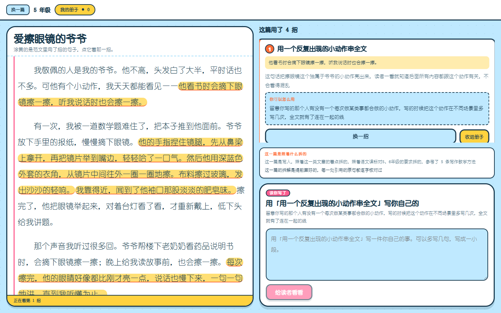
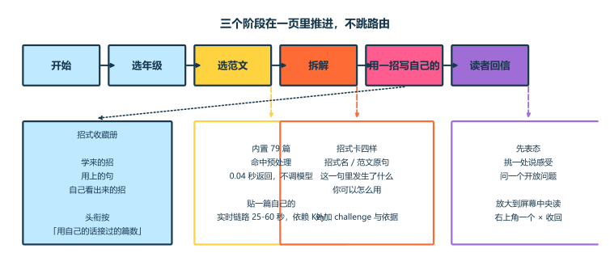
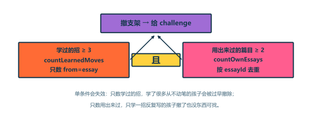
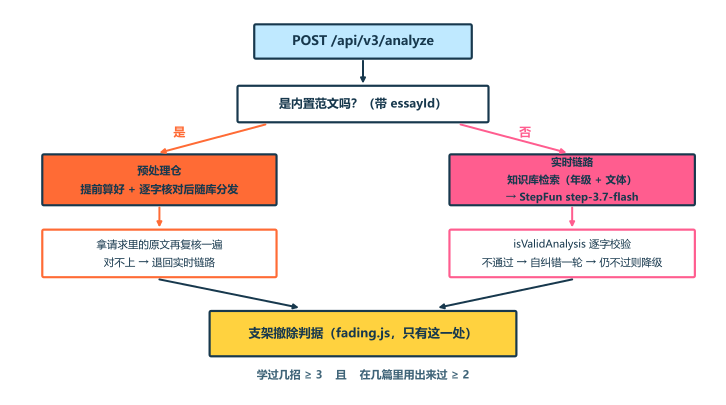

# 范文放大镜

> 拆开一篇优秀范文，让孩子看清"它是怎么写成的"；学一招，写他自己的。

**第二届全国人工智能应用创新大赛 · 教育命题域**

[](LICENSE)


---

## 它解决什么问题

孩子写作文，卡住的地方通常不是"没话写"，是**不知道怎么把一件事写出来**。
让他背好词好句没用——那是质量标准前置，传递的信号是"有些词比另一些词更值得被看见"。

这个产品的做法相反：**拿一篇好范文，拆开它，让孩子看清"这一句是怎么写成的"，
然后自己用这一招写一句。**

三步走完，他手里多了一个能反复用的写法，而不是一句别人的话。

---

## 长什么样



左边是范文，中间是拆出来的招式，右下是写作坞。三个阶段在一页里推进，不跳路由——
从"看懂"到"动手写"之间每多一次页面切换，就多一个放弃点。

---

## 三个阶段

| 阶段 | 做什么 |
|---|---|
| **选范文** | 内置 79 篇自撰示例范文，或贴一篇自己的 |
| **拆解** | 招式卡：招式名 / 范文原句 / 这一句里发生了什么 / 你可以怎么用。外加 `challenge`（让你自己找一句）和依据（照着什么拆的） |
| **用一招** | 孩子写一句自己的，一个"读者"回应他——引用原句、说读到什么、问一个开放问题 |



**支架必须逐步变薄。** 孩子攒够招之后，产品少标几招，让他自己找——
少标的那几招由 `challenge` 还回来。这是布鲁纳支架式教学在产品里的落地：
支架永远不撤就是新型句型填空。



---

## 为什么不配模型 Key 也能用

内置范文是已知且固定的，没有理由在运行时才算。79 篇的拆解由**同一个**
`buildAnalysis` 提前算好、逐字校验后随库分发（`server/data/precomputed/`）：

- 点开内置范文 **0.04 秒**返回，完全不调模型
- 演示现场不可能失败
- 取用时还要拿请求里的原文**再复核一遍**——`essayId` 是客户端给的，文本也是，
  两者没有必然关系

粘贴一篇自己的仍走实时链路（25-60 秒、依赖 Key），这是产品当前最大的风险。



---

## 教学法依据

产品的每个设计决定都有出处，不是拍脑袋。完整清单见
[`docs/wiki/07-引导与激励的实证依据.md`](docs/wiki/07-引导与激励的实证依据.md)
（每条带 Crossref DOI）。

| 设计 | 依据 |
|---|---|
| 拆范文而不是给好词好句 | 王荣生"例文"说——范文的价值是让学生获得**可迁移的写作知识** |
| 支架逐步撤除 | 布鲁纳；Renkl & Atkinson (2003) 的"过渡"要的是暴露量**与**表现都有 |
| 让孩子自己说"这是哪一招" | 认知学徒制的 articulation（Collins, Brown & Newman 1988） |
| 读者单一人格、先表态再挑一处 | Mueller & Dweck (1998)——夸过程不夸人 |
| 不加积分星级排行榜 | 过度辩护效应：追加奖励会让孩子追奖励而不是追写法 |
| 3-6 年级，不做 1-2 | 课标第一学段要的是"乐于运用词语"，不是篇章质量 |

---

## 已验证的底数

| 项 | 结果 |
|---|---|
| 内置范文 | **79/79** 有招、**79/79** 命中预处理、**515 处**引用逐字核对通过 |
| 支架撤除档 | **78/79** 带 challenge（撤了支架就必须给补偿，`precompute-004` 锁着） |
| 评测 | **34/34**（31 离线无 Key 可跑 + 2 在线 + 1 查真仓） |
| 收藏册单测 | **34/34** |
| 行为埋点 | 已上线，属性白名单，只计数不带身份 |

评测判分全部用确定性断言，不上 model-as-judge。超时导致的降级记 SKIP 不记 FAIL——
一个因为模型慢而红的用例，和因为提示词写坏而红的用例在报告里长得一样，
人就会开始忽略红色。

---

## 跑起来

```bash
# 后端（端口 3010——3000 被本机别的服务占了）
cd server
npm ci
cp .env.example .env      # 填 LLM_API_URL / LLM_API_KEY / LLM_MODEL / ACCESS_CODE
npm start

# 前端（另开一个终端）
cd client
npm ci
VITE_API_TARGET=http://localhost:3010 npm run dev
```

打开 http://localhost:5173 。深链：`?grade=5` 跳过选年级，`?essay=<id>` 直接开到拆解。

**没填 Key 也能用**：内置范文命中预处理、`/api/v3/reader` 返回降级话术。

```bash
# 评测与自测
cd server && node --no-warnings eval/run.js                  # 33 条
node --no-warnings ../client/scripts/test-movebook.mjs       # 34 条
bash scripts/check-secrets.sh                                # 提交前必跑
python scripts/make-diagrams.py                              # 重新生成本文的机制图
```

---

## 部署

魔搭创空间：框架 docker / 免费 CPU / 端口 **7860**。

| 环境变量 | 说明 |
|---|---|
| `LLM_API_URL` | OpenAI 兼容端点 |
| `LLM_API_KEY` | 模型 Key。**只存在于服务端**，不进前端、不进镜像历史 |
| `LLM_MODEL` | 模型名 |
| `ACCESS_CODE` | 访问密码，留空不设门槛 |
| `LLM_TIMEOUT_MS` | **显式填 60000**。实测一次读者回应中位数 31 秒、长尾过 60 秒 |

改完环境变量**必须重启创空间**。

---

## 三条红线

优先级高于本仓库其他任何内容。

1. **作品内容零个人信息。** 界面、代码注释、README、`package.json` 的 `author` 字段，
   一律不得出现学校名称、学生姓名、指导教师信息。本工程不提供任何让用户填写
   姓名/学校的输入框，提交作者身份也刻意保持匿名（`edu-agent <edu-agent@local>`）。
2. **API Key 不下前端。** Key 只存在于 `server/`，通过环境变量读取。
   `.env` 同时被 `.gitignore` 和 `.dockerignore` 排除。
3. **期限。** 提交截止 2026-11-10 24:00，截止前 3 天冻结新功能。

---

## 已知限制

不掩饰，这些都是真的：

- **"粘贴一篇自己的"依赖外部模型**：25-60 秒且依赖 Key 有效。内置范文已经不依赖了，这一条还没有
- **多模态是代码渲染，不是 AI 生成。** 对外说"画面由排版、SVG 与 CSS 生成"，
  **不要写"AI 生成动画/绘本"**——那是虚假宣传
- **`online-002` 在 temperature=1 下会抖**，连跑可能出现一次红
- **会话状态不跨部署保留。** 对外表述应为"容器生命周期内持久化"
- **内置范文全部是自撰的示例范文**，不得冒充教材范文或学生真作

---

## 文档

改代码前先读这里，能少问很多"当时为什么这么定"。

| 文档 | 内容 |
|---|---|
| [`docs/HANDOFF.md`](docs/HANDOFF.md) | 当前状态、踩过的坑、下一步 |
| [`docs/wiki/01-产品与方向.md`](docs/wiki/01-产品与方向.md) | 产品是什么、脊柱、已裁掉别加回来的 |
| [`docs/wiki/06-决策与待办.md`](docs/wiki/06-决策与待办.md) | **69 条决策**，每条带"别怎么改" |
| [`docs/wiki/07-引导与激励的实证依据.md`](docs/wiki/07-引导与激励的实证依据.md) | 儿童心理学实证依据，每条带 DOI |
| [`docs/contract.md`](docs/contract.md) | 接口契约（v3） |
| [`编程规范.md`](编程规范.md) | 工程规范，唯一先行文件 |

---

## License

[Apache License 2.0](LICENSE)。内置范文与文档同为此许可证下的原创内容。
